# Research: enemies online, better graphics, new content, menus, colour variants

Written 2026-11-23 from the game's function and class lists (`build/functions.json`, `build/classes.json`) and the
layout files in `common.h2z` (read from the user's own `.ipa`, nothing saved to the repository). Nothing here is built
yet: these are findings and options.

## 1. Enemies are simulated on each machine. Can they be shared?

**What the game does today.** Each machine runs its own enemies. The network protocol (the `BioVS_Prt*` messages)
sends only:

| Sent between machines | Messages |
|---|---|
| Players: position, animation, attacks, damage, deaths, respawns, equipment, healing | `Position`, `Attack`, `AttackRange`, `Damage`, `PlayerDied`, `PlayerStateChanged`, `Respawn`, `Equipment`, `Heal`, `Help`, `Combo` |
| COM players (bots that fill empty slots) | `AiData`, `EntryAI`, `BangAI`; run by `GM_Ai_CtrlRpc` |
| Bullets | `BulletCreate`, `BulletPosition`, `BulletDelete` |
| Map objects (doors, ladders, traps, item boxes, mines) | `Fix`, `FixCreate`, `ReqFixLock` / `Unlock` / `FixLockResult` |
| Dropped items | `ItemCreate`, `ItemGet`, `ItemGive`, `ItemEffect` |
| Score and events | `Score`, `MenaceGauge`, `Summon` (the boss), `Happening` (random events), `TimeExtended`, `VersusCoin*` |
| Kill notices | `CreatureDied` (only shows the "X killed Y" message) |

No message carries an enemy's position, health or AI state. The enemy controller (`GM_CtrlMain_Enemy`: placement,
groups, targets, boss summon) and the enemy models (`Create_ChGna`, `ChCha`, `ChGat`, `ChJya`, `ChSen`, `ChPlgC`)
run locally on every machine. The boss is the one shared piece: `Summon` makes every machine call
`GM_CtrlMain_Enemy::SummonBoss`, but after that each machine moves its own boss.

So two players see different enemies in the same spot, and killing one on your screen doesn't kill it on the other.
That's how the original game works, not a port bug.

**Can it change? Yes, but it is the biggest job on this list.** The port owns the network link: Local Match runs
over the port's own TCP connection (`gamekit.rs`, frames `Hello`, `Accept`, `Deny`, `Data`, `Bye`). A new frame type
(`Port = 6`) can carry extra data the game never sees, so the game's protocol stays as it is.

The plan would be "the host owns the enemies":
1. The host runs enemies as now. Every game step (20 per second) it sends each enemy's position, rotation, animation
   and frame, health, and alive/dead flag over the new frame.
2. Clients stop running enemy AI and movement (skip `GM_CtrlMain_Enemy::Main_Mission` and the enemies' AI updates)
   and copy the host's values into their enemy objects.
3. A client's hit on an enemy goes to the host as a request. The host applies the damage and sends the result back.
4. Spawns (`Set_ChEntry`, `_Check_EntryEn`) happen only on the host and are sent to clients by an id.

Open questions and risks:
- The layout of the enemy objects (`GM_Obj_Ch_Normal`, `GM_Hdl_Ch_Normal`) has to be mapped: where health, state and
  the animation player live.
- Damage paths are many (bullets, knife, explosions, traps, grabs). Each has to go through the host.
- With 12+ enemies the data per second stays small (well under 50 KB/s), so bandwidth is fine on a home network.
- Only port-to-port: a touchHLE player wouldn't understand the new frame. The port should switch it on only when
  both sides are the port.

A cheaper first step: sync only enemy deaths and spawns (kill on the host = kill everywhere). That fixes "I killed
it but you still see it" without moving positions. Enemies would still wander differently.

## 2. Better textures and models

What exists now: 2D images (menus, HUD, fonts) are enlarged 4x by the port or replaced by the user's own AI
upscales (`textures/load`). 3D textures (characters, stages) are PVRTC, a compressed format. Since 2026-11-24 they
go through the same dump/load path (decoded to RGBA, dumped as `<hash>_<w>x<h>_pvrtc.png`, replaceable by hash with
mipmaps); tested on the Docks stage atlas (1024, loaded 4x as 4096) and Chris's 512 atlas.

| Option | Work | Result |
|---|---|---|
| **3D textures to the same pipeline.** Decode PVRTC to RGBA when it loads (the decoder is already in `vendor/PVRTDecompress`), then dump, upscale and load by hash like the 2D images | Medium: the decode is ready. Needs a size limit (VRAM) and a check on how mipmaps are uploaded | Much sharper characters and stages with the user's own Real-ESRGAN. The built-in Lanczos helps less on photos. |
| ~~Anisotropic filtering~~ on 3D textures | Tried 2026-11-24, dropped | Mipmaps + 16x were built and tested by script and by hand: no visible difference, because the port's high render scale already supersamples |
| **Anti-aliasing** (MSAA on the render target) | Small to medium | Smoother model edges. The current high-resolution rendering already helps. |
| **Smoother models.** Subdivide meshes when they load (the game skins them on the CPU, `_mceBoneDeformer`, so more vertices cost CPU time) | Large | Rounder shapes. Risk: seams at UV edges, slower skinning. |
| **Replace whole models** (see section 3) | Large | New or remade models |

Recommended order: 3D textures through the dump/load pipeline, then MSAA.

## 3. New characters and maps, with no game files in the repository

**Images: yes.** Any 2D image the game draws (portraits, character-select cards, stage pictures, loading screens,
icons) can be replaced through `textures/load` by its hash. If the replacement is **your own work** (a render of a
model you made, your own art), it isn't game content and can be shipped with the port or as a separate pack. If it's
made *from* the game's images (an upscale, an edit), it stays on your PC, like the AI upscales.

**Models: an image can't replace a model.** A 3D model needs a model file. The way to do it:
- **File overlay.** `fs.rs` already serves every app file from the `.ipa`. It can check a `mods/` folder first, so a
  file there replaces the one in the `.ipa`. That needs no change to the game code.
- Models, textures and animations sit inside the `Acv_*.bin` archives (`.mcms` models, `.mcts` textures, `.mcas`
  animations). The archive reader exists (`re_tools/acv.py`). Writers for `.mcms` and for the archive are still
  needed, or the overlay can work on single entries inside an archive by name.
- A new character means: model, textures, animations (or reusing an existing skeleton's animations), parameters
  (HP, weapons), text, and the UI images. Reusing an existing skeleton is by far the easiest path.
- Limits found before: 3 playable-character slots are hard-coded in many places, 4 players use model slots 4-7. A
  new character is easiest as a **replacement or variant** of an existing one. Adding a fourth slot means changing
  those limits in many places.
- What can be shipped: models, textures and animations you made yourself. Anything converted from the game stays
  local.

**Maps:** the same overlay works for stage files, but stage data includes collision, enemy placement and spawn
points, so a new map is the largest content job. Retexturing an existing map (section 2 pipeline) is easy.

## 4. Menus: the components the game has, and their states

Every screen is a tree of layout parts loaded from a `.blyt` file (218 layouts in `common.h2z`). All parts derive
from `LYT_CmpProduct`. The port can already read the tree, hide parts, move them and press them (`lyt.rs`).

### Components

The pictures are simple drawings of what each part does (made for this document, not taken from the game). The id is the class number in the `.blyt` records. The class names are matched by their methods and the part names.
The "used" column counts parts across all 218 layouts.

| id | Looks like | Class | Used | What it is | Its own controls / values |
|---|---|---|---|---|---|
| 0 | 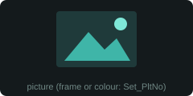 | `LYT_Cmp_Image` | 506 in 172 layouts | Picture (backgrounds, icons, numbers, the `Wait` / `Press` pictures inside buttons) | `Set_PltNo` (which frame or colour of the image), `Set_Scale`, `Set_ImgFocus` (highlight) |
| 1 | 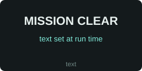 | `LYT_Cmp_String` | 331 in 90 | Text | `SetText_Unicode`, `ClearText`, `Set_PltNo` (text colour) |
| 2 | 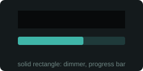 | `LYT_Cmp_FillRect` | 22 | Solid rectangle (dimming backgrounds `FilBlk`, progress bars `ProgBer`) | colour and alpha |
| 3 | 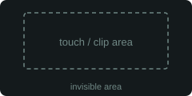 | `LYT_Cmp_Panel` | 73 | Invisible touch or clip area (`TouchArea`, `ViewRect`) | none |
| 4 | 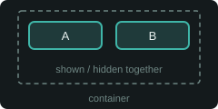 | `LYT_Cmp_Group` | 100 | Container that shows or hides children together (`GrpSel#`, `Sub_Active` / `Sub_NotActive`) | none |
| 5 | 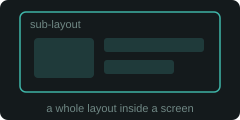 | `LYT_Cmp_Layout` | 83 | A whole sub-layout inside a screen (`Sub_lytScore#`, `Sub_ItemBase`) | none |
| 6 | 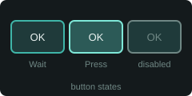 | `LYT_Cmp_Button` | 327 in 64 | Standard button (`BtnOK`, `BtnBack`, `BtnSel#`, `BtnChara#`) | `Set_Press`, `Clear_Press`, `SetText_Unicode`, `SetTitle_Unicode`, its own press sound |
| 7 |  | `LYT_Cmp_ActionButton` | 72 | Gameplay button (`ActBtn_Gun`, `_Knif`, `_Scope`, `_Atsh`, `_Event`) | `Set_BtnType`, `SetScaleAnim` (press animation) |
| 8 | 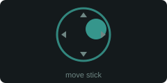 | `LYT_Cmp_VirtualPad` | 12 | Move stick (`Pad`) | touch point, `Set_PltNo` |
| 9 | 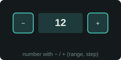 | `LYT_Cmp_Counter` | 3 | Number with − / + (`CounterGun`, `CounterKnife`) | `SetRange`, `SetStep`, `SetValue`, `GetValue` |
| 10 | 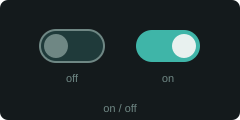 | `LYT_Cmp_Switch` | 2 | On / off switch (`Swt`, `SwtFlip`) | `SetValue` |
| 11 | 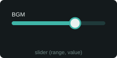 | `LYT_Cmp_Slider` | 4 | Slider (`SldBGM`, `SldSE`, `SldTP`, `SldSH`) | `SetRange`, `SetVal`, `GetVal` |
| 12 | 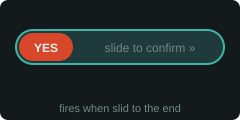 | `LYT_Cmp_SliderButton` | 2 | Slide-to-confirm bar (`SlBtnYes`) | none (fires when slid to the end) |
| 13 | 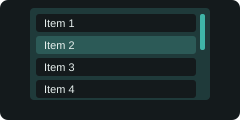 | `LYT_Cmp_TableView` | 5 | Scrolling list (`SelMTblView` and others) | `Set_ItemNum`, `UpdateItems`, `Select_ViewTopItem`, `Get_ViewTopItemIdx` |
| 15 | 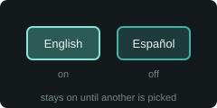 | `LYT_Cmp_ToggleButton` | 16 | Button that stays on (language buttons `BtnEng` / `BtnSpa`, team buttons) | `SetValue`, `GetValue` |
| 16 | 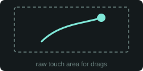 | `LYT_Cmp_InputPanel` | 5 | Raw touch area for drags (`TouchArea` in gameplay) | none |
| 17 | 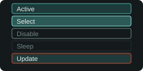 | `LYT_Cmp_TableViewItem` | 30 | One row of a list (`Item#`) | `Set_Index`, `ChangeState` (below) |
| 19 | 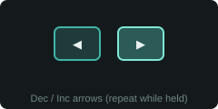 | `LYT_Cmp_PushButton` | 4 | Small repeat button (`Dec`, `Inc`) | `Set_Press`, `Clear_Press` |
| (14, 18) | 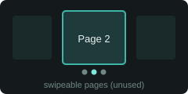 | `LYT_Cmp_PageControl`, `LYT_Cmp_PageControlItem` | not in any layout | Swipeable pages | `Select_CenterPage`, `Set_Page`, `ShowCursor` |

### States every component has

From `LYT_CmpProduct`:

| State | Methods | Notes |
|---|---|---|
| Enabled (can be pressed) | `Set_StateEnable`, `Set_StateEnableTraverse` (with children) | byte +0x50. Greyed-out buttons are disabled. |
| Visible | `Set_StateVisible`, `Set_StateVisibleTraverse` | byte +0x51. Hidden parts aren't drawn, but buttons still take touches: the port hides and blocks them itself, see "Remove". |
| Both at once | `Set_State`, `Set_StateTraverse`, `Clear_CmpState` | |
| Position and movement | `Set_Pos`, `Set_Move` (animated slide), `Get_LytRect`, `Get_LytPoint`, `Resize_NcRect` | |
| Transparency | `Set_Alpha` | |
| Clipping | `Set_ClipTrg` | |
| Sounds | `Set_SE`, `SetSEHandler`, `Reset_SE` | press, slide, switch and list sounds (`LYT_EventSound`) |
| Events | `AddEventHandler`, `postEvent`, `MsgProc` | how a screen hears a press |

Buttons have two picture children, **`Wait`** (normal) and **`Press`** (held), and are dimmed when disabled.

List rows (`TableViewItem`) have five states: **Active, Select, Disable, Sleep, Update**.

### What we can do with menus

- Already done by the port: hide parts, block presses, move them, change text (title credit, Options order).
- Easy next steps: new text, new pictures through `textures/load`, recolouring a part (`Set_PltNo`, `Set_Alpha`),
  reordering buttons, removing whole groups.
- Medium: a **new** button or option on an existing screen. Build it by copying an existing part in memory (same
  class, new name and rect) and handle its press in the port. Example: a "Port settings" button on Options for
  render scale, fps and upscaling.
- Large: a whole new screen. A new `.blyt` file served through the file overlay plus its screen logic in the port.
  Or draw the port's own menu on top of the game, which is simpler and doesn't depend on the game's layout code.

## 5. Colour variants without adding characters

There are two ways in the game code, and both work without new character slots:

**a) Tint (smallest).** The game already gives every model a colour: `GM_ObjBase::Set_MdlColor` and
`Set_MdlBaseColor`, applied each frame by `GM_Obj_ChBase::Set_NormalColor` through `_mceAppearance_setColor`. The game
uses it for power-ups and the death fade (`GM_ObjEff_Color`). The port can set a different colour per player slot.
- Cost: a few lines plus a setting.
- Downside: it tints the whole model (skin too), so it looks like a filter, not a new outfit.

**b) Texture variants (proper recolours).** Each character instance loads its own texture set when it's created
(`GM_CtrlMain_Data::Create_ChPL` for you, `Create_ChRPC` for other players and COM; both call
`GM_Element_MdlTbl::Entry_ErpTex`). The port can mark "player slot N is being created" and, while it is, swap the
textures being uploaded for a variant.
- The variant can be a file (`textures/load/<hash>_v2.png`).
- It can also be a **recipe**: "shift the hue of this texture's red cloth area by 120°" in a small text file, the
  way `tools/textures.txt` lists hashes. The port applies it when the texture loads.
- A recipe is only numbers, so it **can be shipped** with the port. A recoloured image file is made from the game and
  stays local.
- Needs: the 3D-texture decode from section 2 (character textures are PVRTC), a mask so only the outfit changes, and
  a check of whether two players who pick the same character share one texture. If they do, the variant must be a
  second texture name, not an in-place change.
- Choosing the variant: a key or button on character select (the port reads that screen already), saved per player.

Recommended: start with (b) for one character as a test. It also builds the 3D-texture pipeline that section 2 needs.

## Suggested order

1. ~~3D textures decoded and replaceable by hash~~ (done 2026-11-24; needed by 2 and 5). Next: upscale them with Real-ESRGAN.
2. Colour variants by recipe for one character.
3. Enemy deaths synced between port players, then full host-owned enemies.
4. The file overlay (`mods/`) for new models, maps and layouts.
